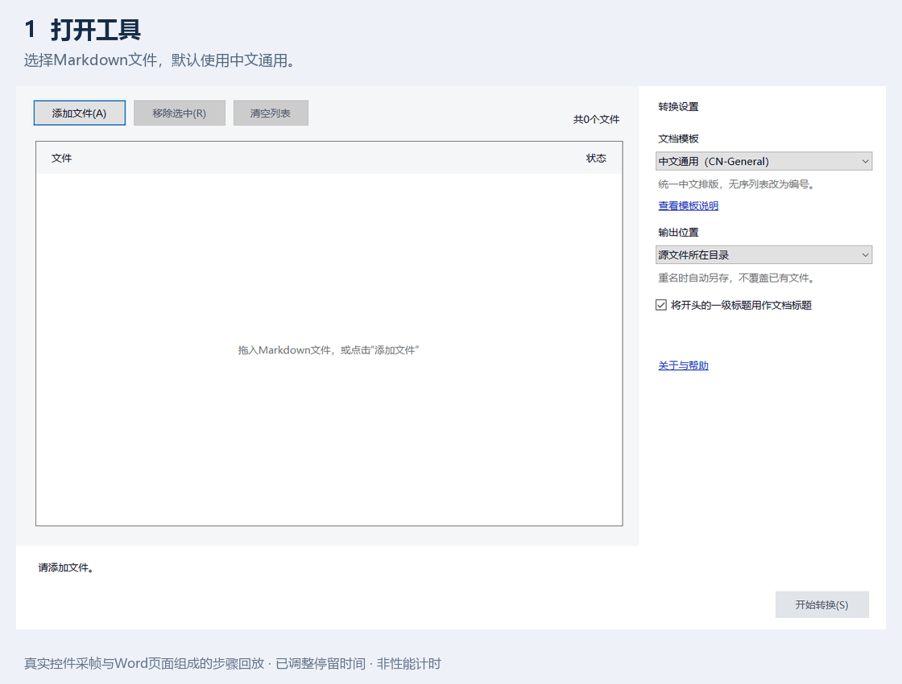

# md2word

Batch-convert Markdown into editable Word documents, with formatting rules for Chinese headings, numbering and tables. Designed for offline use on Windows x64.

[中文说明](README.md) · [Examples](examples/showcase/README.md) · [Contributing](CONTRIBUTING.md)

This 24-second, five-step walkthrough uses real running controls and actual conversions, with adjusted frame durations. It shows a fictional work report and a document containing the user-provided project image. It is not a continuous screen recording or a performance benchmark.

## What it does

- Converts multiple UTF-8 GFM Markdown files into editable DOCX documents.
- Offers a Chinese formatting preset or preserves list types, starting numbers and emphasis.
- Embeds local PNG/JPEG images, avoids overwriting existing documents, and supports cancellation and retry.
- Includes a desktop application and a CLI sharing the same conversion core.

## Try it

**[Download the Windows preview installer v0.1.0-rc.6](https://github.com/ZombieWJ/md2word-desktop/releases/download/v0.1.0-rc.6/md2word-0.1.0-rc.6-win-x64-Setup.exe)** · [Release notes, corresponding sources and checksums](https://github.com/ZombieWJ/md2word-desktop/releases/tag/v0.1.0-rc.6)

Download Setup.exe, install it, and launch Markdown转Word from the Start menu. This is an unsigned offline, per-user Windows x64 prerelease. Portable application ZIPs are not uploaded. Ordinary users only need the installer; source-material ZIPs are for development and license review. Conversion requires no SDK, Pandoc or Word installation.

The main button processes pending and cancelled items only. Retry failed items separately, or explicitly reconvert completed selections through the context menu. Results can be opened or revealed in Explorer. Installed settings are stored in LocalAppData/md2word and survive upgrades and uninstall; portable settings remain beside the executable when portable.flag is present.

Real inputs and downloadable DOCX outputs are linked from the [Chinese README](README.md#转换效果). Examples use synthetic content and were visually checked through Microsoft Word 15.0 / Build15.0.5589 PDF exports.

The first example is a fictional weekly report written from scratch, with numbered headings (1, 2, 3, 3.1, 3.2), a progress table on the first page, and detailed plans for feedback follow-up and workflow checks. It contains no real business records. The image example also uses numbered headings, preserves hexadecimal 0xFF and binary 0b1010, and embeds the user-provided project cover without modifying its image data.

## Current limits

Targets Windows10/11 x64; actual checks currently cover Windows10 Pro22H2. Windows11 and clean-machine checks are pending. Network images are not downloaded. Mermaid and HTML layouts are kept as source with warnings; equation layout is not promised. Markdown preview and arbitrary-document pagination are not provided.

The current preview passed 45 core tests, 23 desktop checks and 54 packaged checks. Historical trial-material checks total 38. With the source-built Pandoc, all 19 PDF pages from 16 fixed and showcase documents were visually reviewed through Word 15.0 / Build15.0.5589 exports. The maintainer has confirmed installation, conversion and uninstall on a real machine; the tested Windows/package versions and offline status are awaiting details. Remaining clean-machine and native desktop interaction checks are tracked separately. Non-developer trials are deferred for this round. GitHub Actions runs Windows builds and tests.

## Build and licensing

See the [development guide](docs/开发指南.md) for the pinned SDK, verified Pandoc setup, builds, tests and CLI usage. After building, run `pwsh -File .\scripts\start.ps1` to launch the desktop application. Development scripts require PowerShell 7.2 or later.

Own code and the owner-authored CN-General template are MIT. Template permission is recorded in its SOURCE.md. Other dependencies retain their own licensing. The preview includes a source-built Pandoc, with complete corresponding sources, exact dependency revisions and build records available in the same Release. Clean-machine and remaining native interaction checks are pending; formal v0.1.0 acceptance is not complete. See [release status](release/RELEASE-STATUS.md) and [third-party notices](THIRD-PARTY-NOTICES.md).
