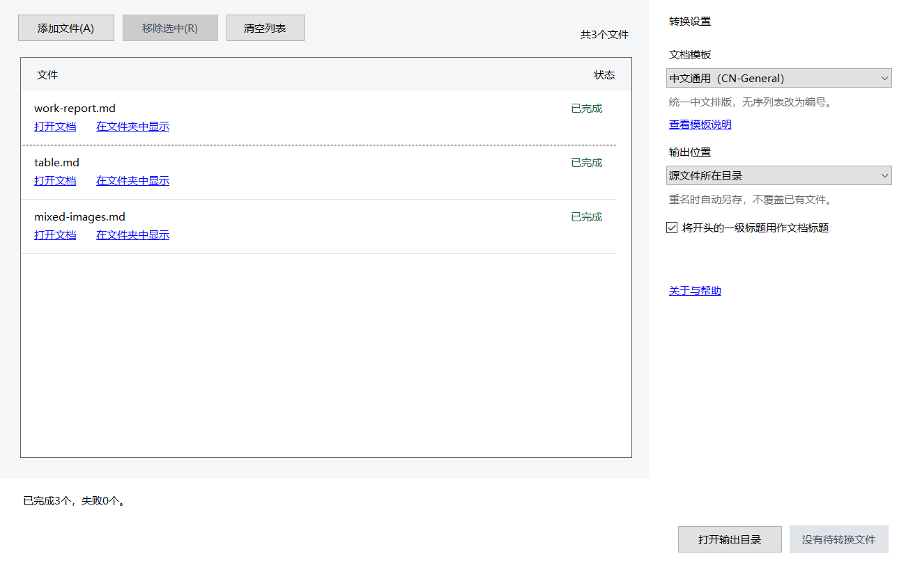
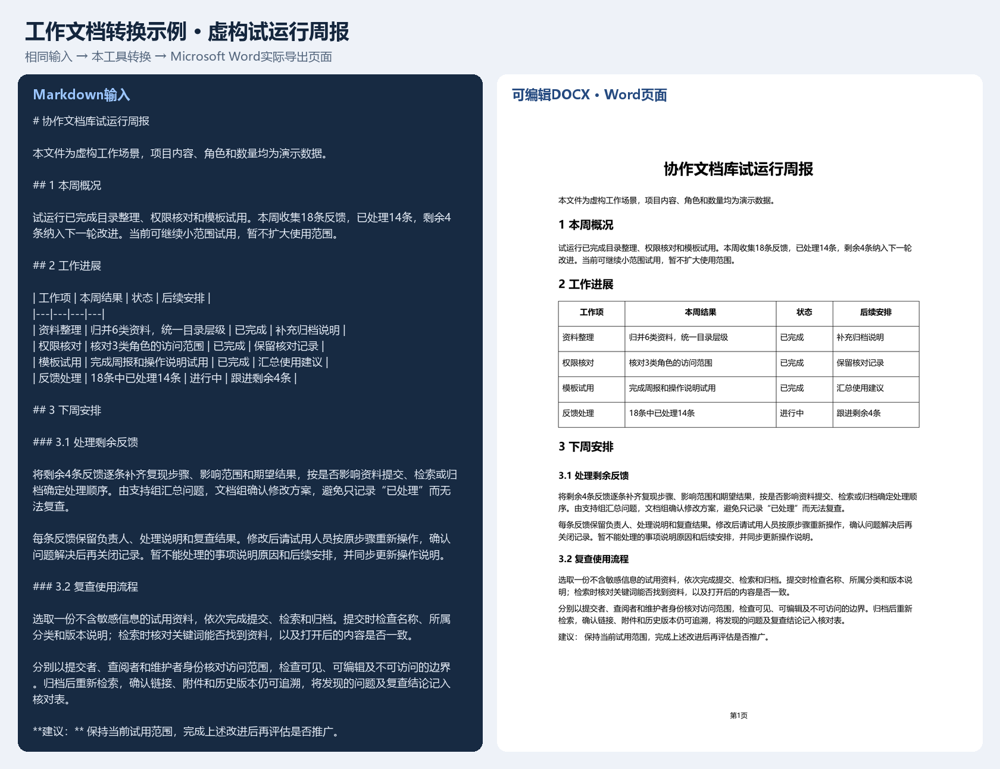
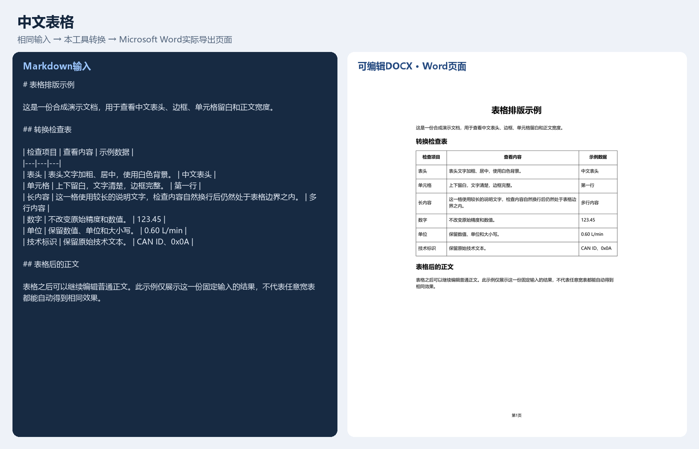
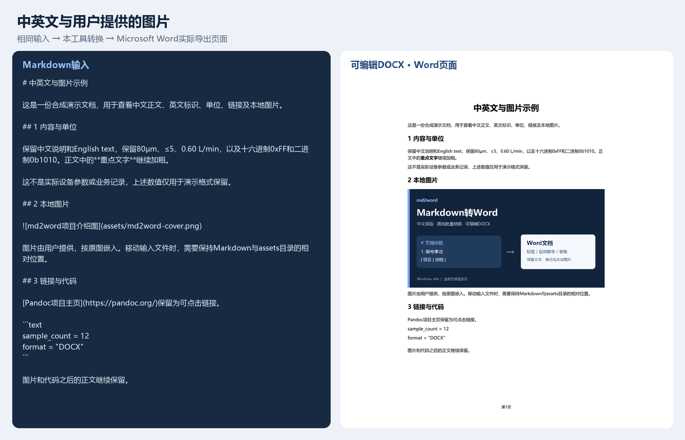

# md2word · 中文Markdown转Word桌面工具

将Markdown批量转换为可编辑的Word，针对中文标题、编号和表格优化，支持离线使用。

[English](README.en.md) · [Windows安装包状态](#试用与下载) · [查看转换样例](#转换效果) · [开发指南](docs/开发指南.md)

- **中文排版**：统一标题、自动编号和基础表格，保留正文中的强调。
- **离线批量转换**：添加多个Markdown文件，逐个转换，本地图片随文档嵌入。
- **保护已有文件**：重名自动另存，单个失败不影响后续文件，取消后保留已完成结果。

演示包含添加文件、查看转换结果、检查周报排版和保留图文等5个步骤，由真实WinForms控件采帧和实际Word导出页面组成。停留时间已调整，不是连续屏幕录像或性能计时。三个输入均实际完成转换，采集方式见[展示验证记录](docs/展示验证记录.md)。

查看静态操作界面

## 试用与下载

**正式安装包尚未开放下载。** 当前源码包含可运行的桌面程序、CLI、模板和构建脚本，开发者可按[开发指南](docs/开发指南.md)构建试用。软件包的未完成项见[发布状态](release/RELEASE-STATUS.md)。

包含Pandoc的安装包需先补齐其完整对应源码与构建材料，源码仓库的公开不代表该项已经完成。

本轮软件发行只提供离线Windows安装包，便携ZIP仅在本地保留，不上传。安装后从开始菜单打开“Markdown转Word”，添加文件并开始转换。

安装包包含运行时、Pandoc和模板，转换无需联网，也无需安装SDK、Pandoc或Word。查看和编辑结果需要能打开DOCX的软件。默认不创建桌面快捷方式，不改变文件关联；每次启动默认选择中文通用。

主按钮只处理待转换及已取消文件；失败可重试，已完成文件可右键“重新转换选中”。结果可打开文档或在文件夹中显示。安装版升级保留设置，卸载保留设置及用户文档。

安装版设置位于当前用户的LocalAppData/md2word。开发者如需自行构建便携包，见[开发指南](docs/开发指南.md)。

本地候选包由[发布脚本](scripts/publish.ps1)生成在`artifacts/releases/`，不进入源码Git记录。正式Release将提供安装包、对应源码材料及校验值；源码材料ZIP供开发与许可核查使用，普通用户只需安装包。本地候选包未签名，不等同于正式发布就绪。

## 转换效果

以下全部为合成样例，DOCX由本工具真实生成。页面来自Microsoft Word 15.0 / Build15.0.5589导出的PDF，并非手绘的Word效果图。每份PDF实际各1页，已逐页检查；不代表任意输入或其他软件版本均通过。

| 场景 | Markdown输入 | Word结果 | 页面预览 |
|---|---|---|---|
| 工作文档：试运行周报，第一页含进展表 | [输入](examples/showcase/work-report.md) | [下载DOCX](examples/showcase/output/work-report.docx) | [查看对照](docs/assets/work-report-comparison.png) |
| 中文表头、边框与单元格留白 | [输入](examples/showcase/table.md) | [下载DOCX](examples/showcase/output/table.docx) | [查看对照](docs/assets/table-comparison.png) |
| 中英文、单位、链接和本地图片 | [输入](examples/showcase/mixed-images.md) | [下载DOCX](examples/showcase/output/mixed-images-numbered.docx) | [查看对照](docs/assets/mixed-images-comparison.png) |

首例《协作文档库试运行周报》从零编写，内容和数量均为演示数据，包含本周概况、工作进展表和下周安排，使用1、2、3、3.1、3.2分级标题，不使用已有业务文档。下周安排说明反馈处理、复核及使用流程检查。图文示例的章节同样带有序号，保留0xFF、0b1010等进制写法，使用用户提供的项目介绍图，原样嵌入DOCX。

查看表格、中英文与图片的实际对照

输入与图片的相对路径、模板允许的变化、文件摘要及复现方法见[样例说明](examples/showcase/README.md)。

## 支持与边界

| 项目 | 当前行为 |
|---|---|
| 文本 | 按GFM解析UTF-8 Markdown；支持标题、段落、列表、基础表格、代码和链接。 |
| 中文通用 | 统一字体、标题、编号和表格；顶层无序事项改为数字编号；正文及列表开头的引导词取消加粗。 |
| 保留方案 | 保留列表类型、编号起点及文字强调，使用基础Word样式。 |
| 图片 | 支持本地PNG/JPEG；缺图时该文件失败；网络图片不下载，保留占位并提示检查。 |
| 公式与Mermaid | 当前不承诺公式排版；Mermaid保留代码并提示，不渲染图形。 |
| HTML | 不支持HTML布局；保留原文并提示可能丢失的内容。 |
| 平台 | 面向Windows10/11 x64；目前实际验证为Windows10专业版22H2，Windows11及干净电脑验证待补。 |
| 分页 | 固定样本已检查，不能保证任意长文、宽表或其他Word版本没有分页问题。 |

本机运行通过与微软官方支持范围分别记录，见[依赖与发布准备](docs/依赖与发布准备.md)。

## 验证状态

- 44项核心与23项桌面自动检查通过；覆盖真实转换、队列、取消、异常和文件保护。
- 本机安装与覆盖升级、53项便携检查、38项试用材料检查通过。
- Microsoft Word15.0/Build15.0.5589下13份固定样例的16个实际页面已逐页检查，未见表格越界、图片裁切或明显分页异常。
- 维护者已确认实机安装、转换和卸载通过；Windows及安装包版本、是否断网待补充。干净Windows10/11与完整系统交互的未验证范围继续保留，非开发用户试用安排后续。固定样例通过不代表任意文档或其他软件版本通过。

检查方法与范围见[当前状态](docs/开发计划与验收.md)，展示采集方式见[展示说明](docs/展示验证记录.md)。GitHub Actions持续运行Windows构建和测试。

## 开发与反馈

构建、CLI、快捷键、安装包和便携包制作见[开发指南](docs/开发指南.md)。源码构建完成后，使用`pwsh -File .\scripts\start.ps1`启动桌面程序。项目使用C#、WinForms、.NET10、Pandoc3.10及Open XML SDK；依赖版本由配置和锁文件固定。“关于与帮助”提供版本和不含正文、路径的诊断信息。

欢迎提交排版样例、问题复现和文档改进，见[参与指南](CONTRIBUTING.md)。可在[Issues](https://github.com/ZombieWJ/md2word-desktop/issues)选择问题或建议表单；提交前删去客户资料、姓名、密钥、内部地址和其他敏感内容。

已实现的变化见[更新记录](CHANGELOG.md)，后续方向及未验证项见[开发计划](docs/开发计划与验收.md)。

## 许可

自有源码及[中文通用模板](templates/cn-general/LICENSE)采用MIT，模板所有者已明确确认授权，见[来源记录](templates/cn-general/SOURCE.md)。Pandoc及其他依赖保留各自许可；Pandoc完整对应源码材料及跨环境验证仍未齐全，当前候选包不作为正式公开发行版本。详情见[第三方说明](THIRD-PARTY-NOTICES.md)。

如果这个工具帮你省去了Word排版时间，欢迎点个Star。
